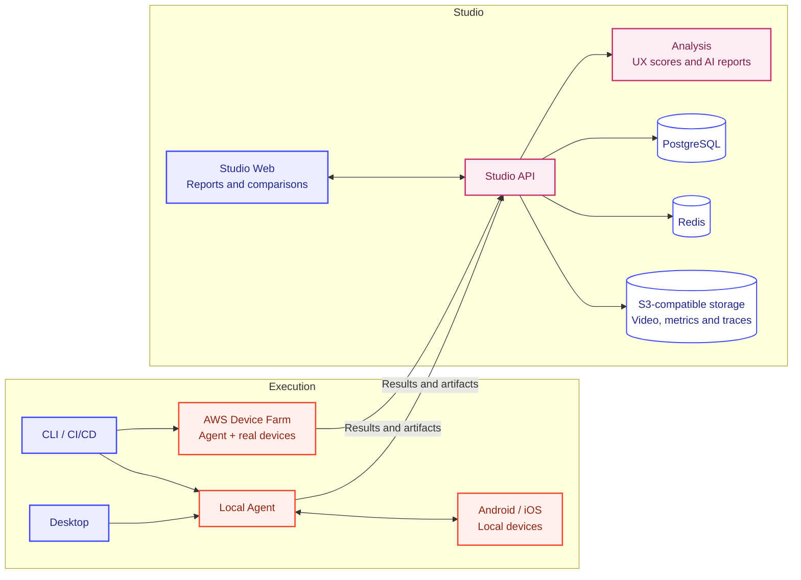

  

**Understand how your mobile app performs, what users experience, and what changes between releases.**

Apptim helps developers, QA engineers, and product teams evaluate Android and iOS apps on real devices. It combines device measurements, recorded user journeys, and AI-assisted analysis to connect performance problems with the moments users encounter them. No SDK integration or changes to the app's source code are needed for supported captures.

## Why use Apptim

- **Find slow or unresponsive flows.** Connect CPU, memory, rendering, startup, and network signals with what happened on screen.
- **Check the impact of a change.** Compare builds on the same devices and flows to identify improvements and regressions.
- **Make release decisions with evidence.** Apply performance and crash gates in CI/CD, and share results with the team.

## How it works

1. **Choose a device and an app.** Connect a local Android or iOS device, or select real cloud devices through AWS Device Farm.
2. **Exercise a user journey.** Use the app manually, run an existing automation script, or describe a goal for an AI-driven run.
3. **Capture performance.** The Apptim Agent collects available device metrics and recordings. Optional Android Deep Trace adds a system trace for deeper investigation.
4. **Review the results in Studio.** Explore timelines and recordings, inspect measured UX scores when available, and use AI-assisted reports to investigate friction and possible improvements. Release comparisons show how compatible builds and flows differ.

## Choose your workflow

- **Desktop**: explore and troubleshoot an app on a device connected to your machine. Supports manual, scripted, and AI-driven runs.
- **CLI and CI/CD**: automate captures, run device matrices, compare releases, and return gate results to your pipeline.
- **Studio**: review measurements and analysis, compare results, ask questions about a run, and collaborate through shared workspaces and reports.

## Architecture

Desktop and local CLI runs use the Agent on your machine. Cloud runs execute the Agent on AWS Device Farm hosts. The Agent handles device interaction and capture; Studio API coordinates result storage and analysis, and Studio Web presents the reports.

Agent and Studio API share the **Domain** package for data models, metric definitions, thresholds, and score rules. Available measurements and analysis depend on the platform, rendering engine, capture options, and plan.

---

[Landing](https://landing-development-b0d7.up.railway.app) · [Studio](https://studio-web-development.up.railway.app) · [Docs](https://docs-development-e6d6.up.railway.app)
