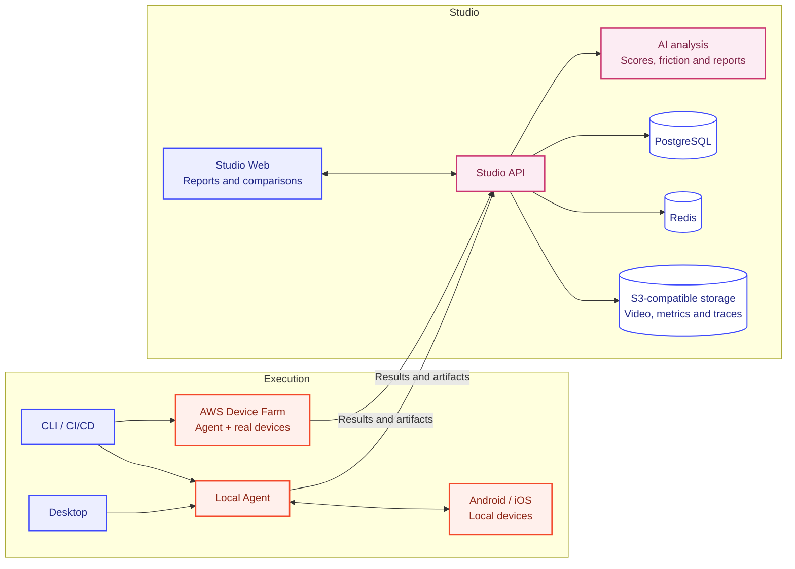

  

**Catch performance and UX regressions in your mobile app before users feel them.**

Apptim helps developers, QA engineers, and product teams understand how Android and iOS apps perform on real devices. Connect device metrics with video and UX analysis to identify when problems happen and compare results across builds.

## Test locally and in CI/CD

- **Apptim Desktop**: run manual, scripted, and AI-driven tests on connected devices.
- **Apptim CLI**: run tests from your terminal or CI/CD pipeline, using local devices or AWS Device Farm.
- **Apptim Studio**: review runs, compare builds, and share performance and UX reports with your team.

## Understand the experience

- Inspect CPU, memory, FPS, energy, and network activity over time.
- Review UX Scores, friction moments, and reports alongside session video.
- Use release gates to catch regressions before shipping.

## Architecture

The Agent captures device measurements and available artifacts. Studio stores results, runs analysis, and presents reports and release comparisons. Desktop and CLI share the same Agent; cloud runs execute it on AWS Device Farm hosts.

The shared **Domain** package defines models, metrics, thresholds, and score rules used by Agent and Studio API. Available signals depend on the platform, rendering engine, capture options, and plan.

---

[Landing](https://landing-development-b0d7.up.railway.app) · [Studio](https://studio-web-development.up.railway.app) · [Docs](https://docs-development-e6d6.up.railway.app)
